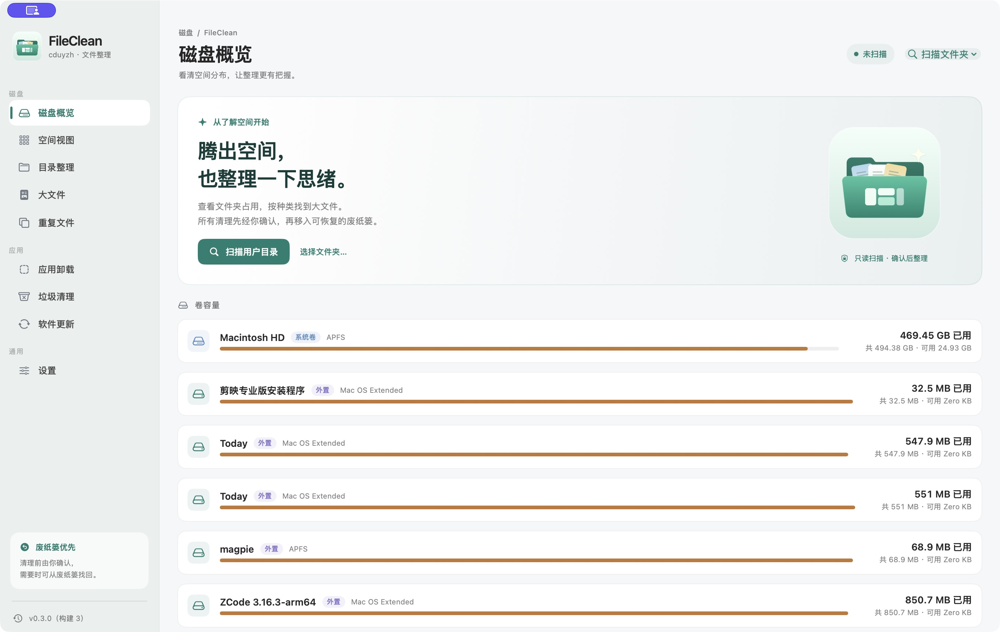
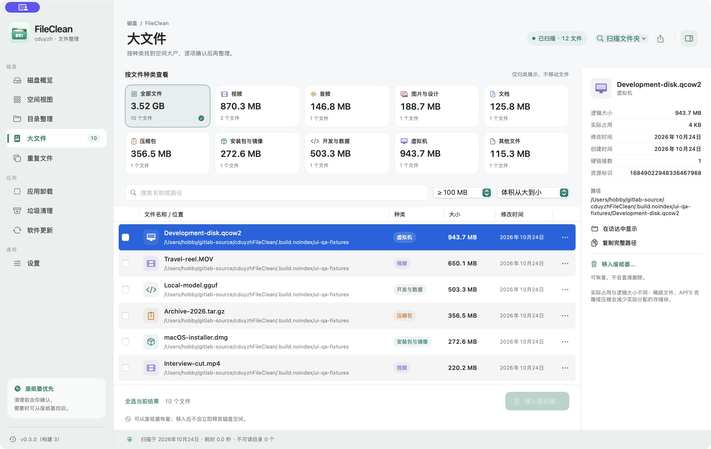

# DiskSweep（磁盘清理大师）

原生 macOS 磁盘与文件清理工具：找出大文件、内容完全一致的重复文件与应用残留，并统一经废纸篓安全删除。


[](https://github.com/cduyzh)

[English](README.md) · **简体中文**

DiskSweep 扫描 Mac 上的真实文件元数据，按体积聚合目录树，归组内容完全一致的重复文件，并列出最占空间的文件。所有日常操作统一经系统废纸篓删除——可恢复、有确认、不静默。原生 SwiftUI / AppKit 应用，macOS 14 及以上，无第三方依赖。





## 功能

- **磁盘概览** — 各卷容量与已用空间；扫描用户主目录后按真实数据聚合一级目录体积与占比。
- **目录整理** — 可逐层展开的目录树，显示每个目录的聚合体积、文件数、目录数与占比；子目录按体积降序排列。
- **大文件** — 按真实体积列出超过阈值（默认 100 MB，可调）的文件；九种类型归类与数量/体积统计、分类与路径搜索组合筛选、三种排序、勾选，以及导出当前筛选结果 CSV。
- **重复文件检测** — 体积分组 → 采样哈希（跳过文件头，大文件三点采样）→ 全量 SHA-256 的三级过滤；只有内容逐字节一致的文件才归组。SQLite 哈希缓存以（路径、大小、修改时间）为键持久化摘要，二次扫描未变化文件零读盘，并在扫描后修剪失效键。
- **硬链接会计** — 多硬链接文件在扫描中只按一个 inode 计一次体积；重复组内共享 inode 的路径标注「删除不释放空间」，可回收量按不同 inode 数计算。
- **安全删除** — 日常界面统一移入废纸篓（可恢复）并二次确认；移动失败绝不转为直接删除。核心 API 默认 `.trash`，仅保留显式永久删除能力用于兼容；处理前重新读取未缓存的 inode、大小与修改时间，与扫描快照不一致即跳过；系统位置与本产品自身受保护。卸载、垃圾清理共用同一删除通道与确认语义。
- **应用卸载** — 列出 /Applications、~/Applications 与系统位置的全部应用；标识符缓存 + 精确/增强两档灵敏度搜索 Library 残留（偏好、缓存、应用数据、日志、启动项、辅助工具）；Containers 通过容器元数据精确归属；卸载时应用包与勾选残留一并移入废纸篓；应用本体处理失败时不动关联残留。
- **垃圾清理** — 反向枚举用户 Library 顶层条目，与全部已安装应用的标识符比对；无主条目（孤儿缓存、偏好、容器、启动项）列为候选，系统前缀自动排除。
- **软件更新** — 对 Sparkle 自更新源（RSS appcast）与 App Store 公开 lookup 两类真实来源做按需检查；无更新源的应用如实标注「无更新源」，不冒称已最新。
- **空间视图** — squarified treemap + 坐垫高光，面积与目录真实体积成正比；点击下钻、面包屑返回、悬停明细。
- **快照提示** — 解析 `tmutil` 真实输出列出 APFS 本地快照，估算可清除空间；删除快照需管理员权限，本工具不提权，给出磁盘工具入口指引。
- **详情面板** — 选中文件的逻辑大小、实际占用、创建/修改时间、硬链接数、资源标识与完整路径。
- **清单导出** — 大文件与重复文件列表导出 CSV，UTF-8 BOM，防护电子表格公式注入。
- **设置** — 外观（系统/浅色/深色）、大文件阈值、重复检测最小体积、隐藏文件跳过。
- **版本与历史** — 当前版本、构建号、构建时间、来源摘要与正式安装状态；完整本地更新历史。

## 安全模型

清理工具绝不能让你意外——安全是 DiskSweep 的核心设计目标。

- **废纸篓优先，始终如此。** 界面中所有删除操作都在显式确认后移入系统废纸篓。移动失败时文件原地保留——应用绝不把失败的移动转成永久删除。废纸篓中的文件仍可在访达恢复。
- **处理前二次核对。** 文件被处理前，应用会重新读取未缓存的 inode、大小与修改时间并与扫描快照比对；期间发生任何变化的文件都会被跳过并说明，绝不静默处理。
- **受保护位置。** 系统位置与 DiskSweep 自身受删除保护。应用从不申请管理员提权；受 SIP 或 TCC 限制的路径如实标注为不可读取，而不假装为空；全盘位置需要系统设置的完全磁盘访问权限。

## 下载与安装

1. 从 [Releases](https://github.com/cduyzh/DiskSweep/releases) 下载最新 DMG。
2. 打开 DMG，将 **DiskSweep** 拖入「应用程序」文件夹。
3. 首次启动时右键点按应用并选择「打开」（未做 Developer ID 公证的应用只需一次）。
4. 如需全盘扫描，请在 系统设置 → 隐私与安全性 中授予「完全磁盘访问权限」。

## 从源码构建

需要 macOS 14 或更新版本上的 Xcode 或 Command Line Tools（Swift 5.9+）。

```bash
git clone https://github.com/cduyzh/DiskSweep.git
cd DiskSweep
./build_app.sh
```

脚本只构建当前项目的应用包，不会自动安装。也可以在仓库根目录直接运行 `swift build` 与 `swift test`。

## 版本历史

当前版本：**0.3.0**（构建 3）。完整历史见 [CHANGELOG.md](CHANGELOG.md)。

## 隐私

扫描为本地只读操作：DiskSweep 只读取你 Mac 上的文件元数据，不上传任何内容。唯一的网络请求是你手动触发的软件更新检查（Sparkle appcast 或 App Store 公开查询）。

## 许可证

以 [MIT License](https://opensource.org/license/mit) 发布。

## 作者

**cduyzh**

- GitHub：<https://github.com/cduyzh>
- 个人网站：<https://www.cduyzh.top>
- Goal：<https://www.cduyzh.top/goal>
